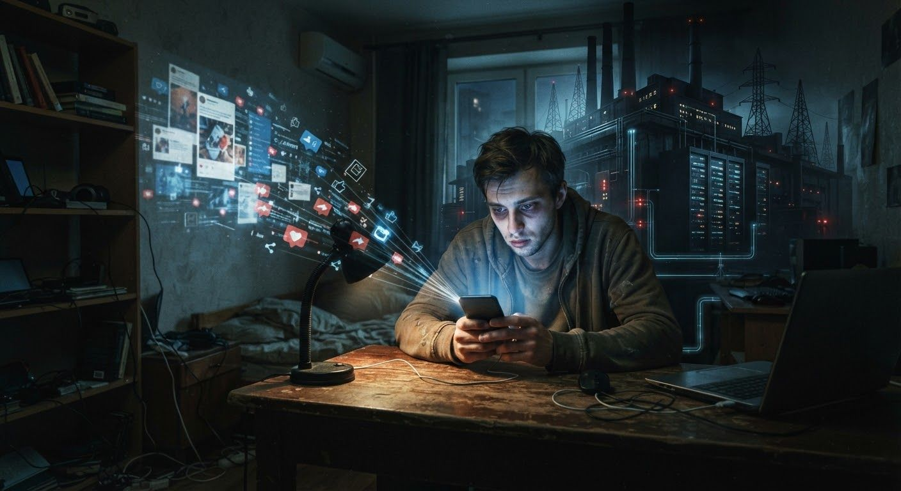
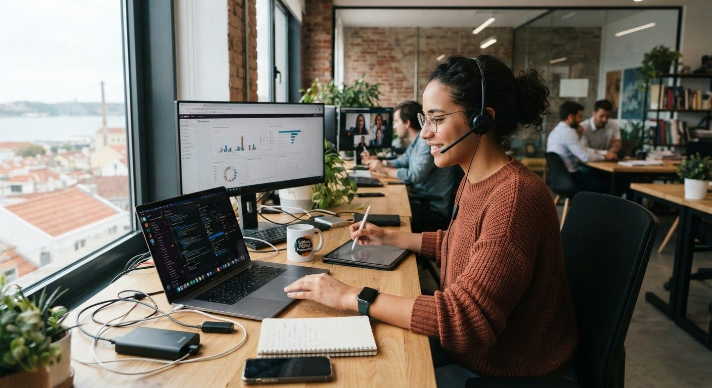

As redes sociais são reflexo da sociedade actual. Hoje, o meio de produção cultural não se confina aos limites físicos da fábrica mas está diluído geograficamente. Os "operários" fabricam as mensagens, grosso modo, numa ilusão de participação livre e consciente. Contudo esta sua iniciativa está fortemente condicionada. O operário digital contemporâneo paga do seu próprio bolso o meio de produção (telemóvel, computador, etc.) para desenvolver conteúdos de forma voluntária e gratuita na ilusão de independência. Produz enquanto julga que está a exercer a sua liberdade de expressão. No entanto, ele não é um criador soberano, mas um trabalhador não remunerado que alimenta a base de dados das grandes corporações.

As grandes corporações tecnológicas (*big tech* - Google, Apple, Microsoft, Amazon, Meta, etc.) mantêm o controlo dos meios de produção tanto através da implementação do modelo de organização laboral como pela logística com que difundem essas mensagens. Ou seja, elas seleccionam quais mensagens são transmitidas bem como, quando e para quem elas se destinam. Isto através do chamado algoritmo. Assim, se a produção se espalhou pelas ruas, o controlo dos meios de distribuição continua concentrado nas mãos da burguesia tecnológica — os donos dos servidores, das redes e das infraestruturas. Acima de tudo, dos algoritmos. As elites serializam, processam e cronometram o fluxo das mensagens. É o capital quem decide o que é transmitido, quando, como e para quem.

    

Devido à dinâmica actual, a recepção dessas mensagens é feita sem muito tempo disponível para reflectir, o que resulta numa mensagem consumida sem processamento crítico. Um catálogo de estímulos é-nos apresentado de forma vertiginosa, usualmente durante o nosso período de ócio. Isso não dá tempo, por um lado, de n)os afastarmos do período laboral nem, por outro lado, espaço para contemplar e reflectir. O sistema coloniza o momento em que deveríamos estar a recuperar as forças, a contemplar o mundo ou a silenciar a mente. A exaustão do trabalho produtivo estende-se, sem interrupção, ao tempo de descanso.

O capitalismo tardio caracteriza-se pela dissolução das fronteiras entre o tempo de trabalho e o tempo de descanso. Ao extrair mais-valia da atenção do utilizador no seu tempo de ócio, o sistema transforma o cidadão num "trabalhador não remunerado". Enquanto as redes sociais e os produtos digitais operam uma *desencarnação* — abstraem o corpo, fragmentam a atenção e convertem a experiência humana num fluxo contínuo de dados consumidos de forma passiva —, a indústria cultural explora a vulnerabilidade do ego: a necessidade de validação externa, o medo da exclusão e a incapacidade de tolerar o vazio. O algoritmo alimenta-se da ansiedade e da exaustão.

A resposta perante este estado de coisas não passa por uma escolha simplista entre o **pessimismo paralisante** (aceitar que somos meros joguetes do algoritmo) ou o **voluntarismo ingénuo** (acreditar que basta "desligar o telemóvel" para ficar a salvo do sistema).

Antropologicamente, o ser humano constituiu-se através da **relação táctil com o mundo real**: o uso das mãos, a transformação da matéria, a percepção do tempo natural e a convivência presencial em comunidade.

Assim, para resistir ao domínio das redes sociais, podemos tomar algumas atitudes, como sejam:

- **Militar pela soberania do tempo**. Proteger o tempo de descanso e de contemplação, limitando e diminuindo a exposição às redes sociais.
- A **apropriação consciente do uso dos meios**. Deixar de usar a tecnologia como um consumidor passivo que reage a estímulos e passar a usá-la como um **instrumento soberano de arquivo, reflexão e difusão de pensamento próprio**. Em vez de alimentar a base de dados do grande capital com reações emocionais e efémeras, o indivíduo pode construir a sua própria infraestrutura duradoura (como um portal pessoal, um diário de campo ou uma obra autónoma).
- **Cultivar o Centro Interior e o Silêncio**. Desenvolver a capacidade de estar a sós com os próprios pensamentos, sem a necessidade de anestesiar a mente com estímulos constantes. Trata-se de passar de uma postura de *reatividade emocional* para uma postura de *observação reflexiva*. Quando o psiquismo recupera o espaço do silêncio, a mensagem hegemónica perde a sua capacidade de hipnose; o indivíduo passa a "descodificar" o mundo em vez de ser programado por ele.
- O indivíduo deve  ancorar a sua existência na **matéria e no trabalho táctil**. A produção de artefactos reais (o cultivo da terra, o trabalho de bancada, a culinária, o desenho, a escrita manual) funciona como um antídoto contra a alienação digital. Quem sabe *fazer* e *transformar a matéria* com as próprias mãos desenvolve uma imunidade natural ao consumo passivo de ilusões virtuais. A matéria devolve o sentido de realidade que o ecrã retira.
- Promover as **relações de vizinhança com a comunidade local**, investindo nos laços humanos de proximidade através do contacto directo com o outro e recuperando práticas históricas e tradicionais que façam sentido.
