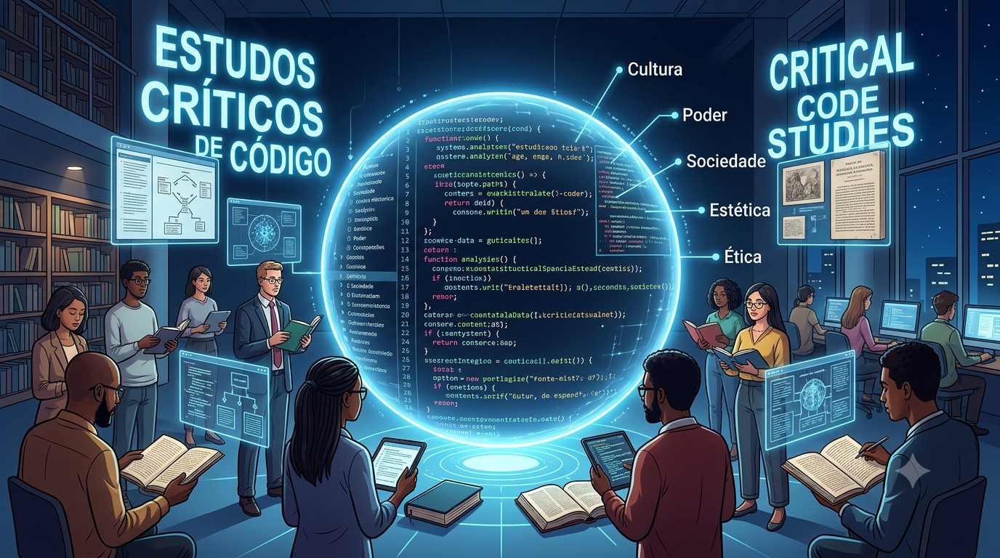

<figure style="text-align: center; margin: 30px 0;">
  
  <figcaption style="font-family: var(--font-mono); font-size: 0.85rem; color: var(--muted-color); margin-top: 8px;">
    Critical Code Studies - Estudos Críticos do Código
  </figcaption>
</figure>

Os **Estudos Críticos do Código** (*Critical Code Studies* — CCS) constituem um campo interdisciplinar no âmbito das Humanidades Digitais dedicado à interpretação do código-fonte computacional enquanto artefacto cultural, político e ideológico.

### **​Conceitos e Eixos Fundamentais**

- ​**Sentido Extra-funcional:** O foco de análise não se esgota naquilo que o código executa na máquina (a sua função técnica), mas no sentido que emerge da sua escrita — as escolhas sintácticas, as metáforas, a convenção de nomes e os comentários deixados pelos programadores.
- ​**Abertura da Caixa Negra:** A passagem metodológica da análise da superfície visual e da interface (*front-end*) para o exame crítico da estrutura algorítmica profunda (*back-end*).
- ​**O Código como Texto:** A aplicação da hermenêutica das Humanidades ao código-fonte, tratando-o como uma linguagem humana impregnada de valores sociais e relações de poder.

### **​Figuras, Marcos e Cronologia**

- ​**Mark C. Marino:** Teórico e professor na Universidade do Sul da Califórnia (USC), responsável pela formalização do campo no ensaio seminal de 2006 (*«Critical Code Studies»*) e pela publicação do livro homónimo (*MIT Press*, 2020).
- ​**Critical Code Studies Working Group (CCSWG):** Grupo internacional de investigação e seminário bi-anual em linha, iniciado em 2010, que reúne humanistas, programadores e teóricos da cultura.
- ​**Nick Montfort e Noah Wardrip-Fruin:** Investigadores essenciais no estudo da poética do código e das *Software Studies* no MIT e na UC Santa Cruz.

### ​**Hiperligações e Recursos de Investigação**

- ​**Portal Oficial e Hub da Comunidade:** [Critical Code Studies Hub](https://criticalcodestudies.com)
- ​**Obra Fundacional (MIT Press):** [Critical Code Studies — Mark C. Marino](https://mitpress.mit.edu/9780262043656/critical-code-studies/)
- ​**Repositório de Discussão:** [Humanities Commons / CCS Working Group](https://hcommons.org)
- ​**Arquivo do Laboratório (USC):** [Humanities and Critical Code Lab](https://dornsife.usc.edu)
